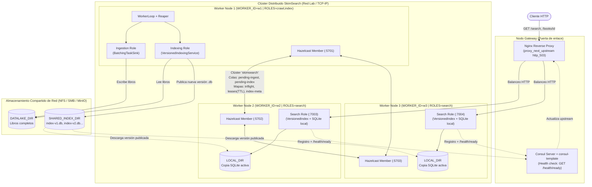
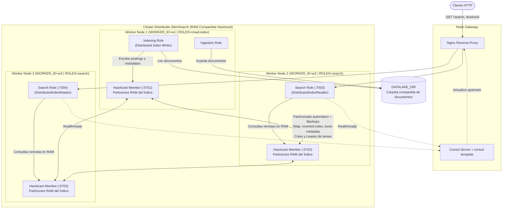

# Guía de Despliegue — SkimSearch Stage 3

Sistema distribuido de ingesta, indexación y búsqueda ejecutado mediante un **binario único (`worker.jar`)** que activa roles dinámicamente por configuración y coordina tareas, bloqueos y metadatos de versión sobre un clúster **Hazelcast (`skimsearch`)**.

---

## 1. Arquitectura y Decisiones de Despliegue

* **Programa trabajador único (`worker`):** Cada nodo ejecuta `worker/target/worker.jar` configurando su identidad (`WORKER_ID`) y sus roles (`WORKER_ROLES`: `crawl`, `index`, `search`, o combinaciones separadas por comas).
* **Coordinación y tolerancia a fallos (Hazelcast):**
  * **Colas de trabajo:** `tasks-pending-ingest` y `tasks-pending-index` (`IQueue`), consumidas de forma atómica (`poll()`) según los roles activos de cada trabajador.
  * **Tolerancia a caídas (*Leases* + *Reaper*):** Mapa `tasks-inflight` combinado con `task-leases` con TTL (`LEASE_TTL_MS`), renovación periódica (`LEASE_RENEW_MS`) y un hilo *reaper* en todos los nodos (`REAPER_INTERVAL_MS`) que reencola tareas huérfanas sin depender de sincronización de relojes entre máquinas.
  * **Exclusión mutua de indexación:** `HazelcastBuildLock` serializa la construcción y publicación de versiones de índice.
  * **Agrupación por lotes (`BatchingTaskSink`):** Agrupa libros listos en lotes de tamaño `INDEX_BATCH_SIZE` o cada `INDEX_BATCH_FLUSH_MS` ms antes de encolar tareas `index`, evitando generar una versión completa de SQLite por cada libro individual.
* **Almacenamiento y Diseños:**
  * **Diseño A:** Documentos en `DATALAKE_DIR` (carpeta compartida) e índices SQLite inmutables por versión en `SHARED_INDEX_DIR`. Cada nodo `search` copia la versión publicada a su `LOCAL_DIR` antes de responder `200` en `GET /health/ready`.
  * **Diseño B:** Documentos en `DATALAKE_DIR` e índice invertido repartido en la memoria RAM del clúster Hazelcast (`IMap`), eliminando la copia de ficheros `.db` por nodo.
* **Enrutado y descubrimiento (`deploy/gateway/`):** Consul descubre instancias saludables mediante `GET /health/ready` y `consul-template` regenera el *upstream* de Nginx, que reintenta automáticamente ante códigos `503` (`proxy_next_upstream error timeout http_503`).

---

## 2. Diagramas de Despliegue

### 2.1. Diseño A — Índice SQLite versionado en carpeta compartida + réplica local en Search



### 2.2. Diseño B — Índice invertido distribuido en la RAM de Hazelcast



---

## 3. Requisitos Previos

* **Java 17+** y **Maven 3.8+**.
* **Red:** Puertos abiertos entre los ordenadores del laboratorio:
  * `5701+`: Comunicación interna del clúster Hazelcast (`portAutoIncrement=false`).
  * `7003+`: API HTTP de cada instancia `search`.
  * `80` / `8080`: Puerto público de Nginx en el nodo *gateway*.
  * `8500`: API HTTP de Consul en el nodo *gateway*.
* **Almacenamiento compartido:** Carpeta de red montada en todos los nodos que ejecuten `crawl`, `index` o `search` (Diseño A).

---

## 4. Compilación

Desde la raíz del repositorio:

```powershell
# Windows (PowerShell)
.\scripts\build.ps1
```

```bash
# Linux / macOS
mvn clean package -DskipTests
```

Genera el ejecutable autocontenido en `worker/target/worker.jar`.

---

## 5. Variables de Entorno

| Variable | Obligatoria | Por defecto | Descripción |
| :--- | :---: | :--- | :--- |
| `RUN_ID` | Sí (pruebas) | `local-dev` | Identificador de ejecución: `<diseño>-<servicio>-<n>nodes-runNN` (ej. `A-worker-2nodes-run01`). |
| `WORKER_ID` | Sí | Aleatorio | Identificador único del proceso (ej. `w1`, `w2`). |
| `WORKER_ROLES` | Sí | `search` | Roles activos separados por comas: `crawl`, `index`, `search`. |
| `HZ_CLUSTER_NAME` | No | `skimsearch` | Nombre del clúster Hazelcast. |
| `HZ_PORT` | Sí | `5701` | Puerto TCP de Hazelcast en este proceso (debe ser único por IP). |
| `HZ_PUBLIC_ADDRESS` | En multi-PC | *(vacío)* | IP:puerto visible por el resto de PCs (ej. `192.168.1.11:5701`). |
| `HZ_MEMBERS` | Sí | `127.0.0.1` | Lista separada por comas de miembros TCP-IP del clúster. |
| `DATALAKE_DIR` | Sí (`crawl`/`index`) | `data/datalake` | Ruta a la carpeta compartida del datalake. |
| `SHARED_INDEX_DIR` | Sí (`index`/`search` A) | `data/shared-index` | Ruta a la carpeta compartida de versiones del índice. |
| `LOCAL_DIR` | Sí (`search` A) | `data/local/<id>` | Directorio local donde `search` copia su SQLite activo. |
| `SEARCH_PORT` | Sí (`search`) | `7003` | Puerto HTTP del servicio Search. |
| `SEARCH_THREADS` | No | `4` | Hilos del servidor HTTP de Search. |
| `CONSUL_URL` | Con gateway | *(vacío)* | URL del agente Consul (ej. `http://192.168.1.10:8500`). |
| `SEARCH_ADVERTISE_HOST` | Con gateway | `127.0.0.1` | IP con la que Search se registra en Consul. |
| `LEASE_TTL_MS` | No | `6000` | Tiempo de vida (ms) del *lease* de una tarea reclamada. |
| `LEASE_RENEW_MS` | No | `2000` | Periodo (ms) de renovación del *lease* mientras la tarea corre. |
| `REAPER_INTERVAL_MS` | No | `1000` | Frecuencia (ms) con la que el *reaper* busca *leases* caducados. |
| `TASK_MAX_ATTEMPTS` | No | `3` | Número máximo de intentos antes de mover una tarea a `tasks-failed`. |
| `INDEX_BATCH_SIZE` | No | `5` | Número de libros listos agrupados antes de crear una tarea `index`. |
| `INDEX_BATCH_FLUSH_MS` | No | `3000` | Tiempo máximo (ms) antes de volcar un lote parcial de `index`. |
| `SEED_BOOKS` | No | *(vacío)* | Lista opcional de IDs iniciales para encolar tareas `ingest` al arrancar. |

---

## 6. Despliegue en el Laboratorio (Varios Ordenadores)

### Paso A — Nodo Gateway (Consul + Nginx)
En la máquina designada como puerta de enlace, seguir las instrucciones de [`deploy/gateway/README.md`](gateway/README.md) para arrancar Consul Server, `consul-template` y Nginx.

### Paso B — Nodos Worker (Ejemplo con 3 PCs en red `192.168.1.x`)

* **PC 1 (`192.168.1.11`) — Roles `crawl,index`:**
  ```bash
  export RUN_ID="A-e2e-3nodes-run01"
  export WORKER_ID="w1"
  export WORKER_ROLES="crawl,index"
  export HZ_PORT=5701
  export HZ_PUBLIC_ADDRESS="192.168.1.11:5701"
  export HZ_MEMBERS="192.168.1.11:5701,192.168.1.12:5701,192.168.1.13:5701"
  export DATALAKE_DIR="/mnt/shared/datalake"
  export SHARED_INDEX_DIR="/mnt/shared/indexes"
  java -jar worker/target/worker.jar
  ```

* **PC 2 (`192.168.1.12`) — Rol `search`:**
  ```bash
  export RUN_ID="A-e2e-3nodes-run01"
  export WORKER_ID="w2"
  export WORKER_ROLES="search"
  export HZ_PORT=5701
  export HZ_PUBLIC_ADDRESS="192.168.1.12:5701"
  export HZ_MEMBERS="192.168.1.11:5701,192.168.1.12:5701,192.168.1.13:5701"
  export SEARCH_PORT=7003
  export SEARCH_ADVERTISE_HOST="192.168.1.12"
  export CONSUL_URL="[http://192.168.1.10:8500](http://192.168.1.10:8500)"
  export SHARED_INDEX_DIR="/mnt/shared/indexes"
  export LOCAL_DIR="/tmp/skimsearch-w2"
  java -jar worker/target/worker.jar
  ```

* **PC 3 (`192.168.1.13`) — Rol `search`:**
  Idéntico al PC 2 cambiando `WORKER_ID="w3"`, `HZ_PUBLIC_ADDRESS="192.168.1.13:5701"`, `SEARCH_ADVERTISE_HOST="192.168.1.13"` y `LOCAL_DIR="/tmp/skimsearch-w3"`.

---

## 7. Scripts Auxiliares y Análisis de Tolerancia a Fallos

### Gestión del ciclo de vida (Windows PowerShell)
* **Arrancar worker en segundo plano:**
  ```powershell
  .\scripts\start-worker.ps1 -WorkerId w1 -Roles "crawl,index" -RunId A-worker-2nodes-run01 -HzPort 5701 -Background
  ```
* **Parada ordenada o caída forzada (`-Force`):**
  ```powershell
  .\scripts\stop-worker.ps1 -WorkerId w2 -RunId A-worker-2nodes-run01 -Force
  ```
* **Experimento automatizado de caída y relevo (*failover*):**
  ```powershell
  .\scripts\run-failover-experiment.ps1 -RunId A-worker-2nodes-run04 -LeaseTtlMs 4000 -LeaseRenewMs 1500 -ReaperIntervalMs 500
  ```

### Logs y extracción de métricas
Cada proceso escribe eventos estructurados (`ts=<Instant> event=<nombre> workerId=<id> ...`) en `logs/<RUN_ID>/worker-<WORKER_ID>.log`.

Para generar automáticamente la **matriz trabajador × tarea** y calcular los **tiempos de relevo ante caída** tras una ejecución:

```bash
java scripts/worker/AnalyzeWorkerLogs.java A-worker-2nodes-run04
```