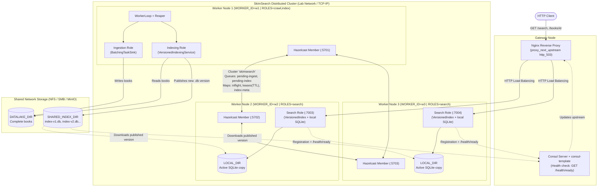
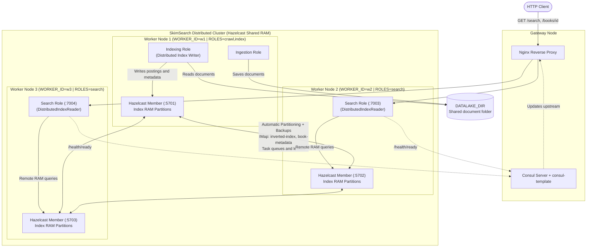

# Deployment Guide — SkimSearch Stage 3

Distributed ingestion, indexing, and search system executed via a **single binary (`worker.jar`)** that dynamically activates roles by configuration and coordinates tasks, leases, and index version metadata across a **Hazelcast (`skimsearch`)** cluster.

---

## 1. Architecture and Deployment Decisions

* **Single worker binary (`worker`):** Each node runs `worker/target/worker.jar` configured with its identity (`WORKER_ID`) and roles (`WORKER_ROLES`: `crawl`, `index`, `search`, or comma-separated combinations).
* **Coordination and fault tolerance (Hazelcast):**
  * **Work queues:** `tasks-pending-ingest` and `tasks-pending-index` (`IQueue`), consumed atomically (`poll()`) according to each worker's active roles.
  * **Crash recovery (*Leases* + *Reaper*):** `tasks-inflight` map paired with `task-leases` with TTL (`LEASE_TTL_MS`), periodic renewal (`LEASE_RENEW_MS`), and a *reaper* thread across nodes (`REAPER_INTERVAL_MS`) that requeues orphaned tasks without relying on clock synchronization across machines.
  * **Indexing mutual exclusion:** `HazelcastBuildLock` serializes index version builds and publication.
  * **Batching (`BatchingTaskSink`):** Groups ready books into batches of size `INDEX_BATCH_SIZE` or every `INDEX_BATCH_FLUSH_MS` ms before enqueueing `index` tasks, avoiding full SQLite index builds per individual book.
* **Storage and Designs:**
  * **Design A:** Documents in `DATALAKE_DIR` (shared folder) and immutable versioned SQLite indexes in `SHARED_INDEX_DIR`. Each `search` node copies the published version to its `LOCAL_DIR` before returning `200` on `GET /health/ready`.
  * **Design B:** Documents in `DATALAKE_DIR` and an inverted index distributed across Hazelcast cluster RAM (`IMap`), eliminating per-node `.db` file copying.
* **Routing and service discovery (`deploy/gateway/`):** Consul discovers healthy instances via `GET /health/ready`, `consul-template` regenerates the Nginx *upstream*, and Nginx automatically retries on `503` responses (`proxy_next_upstream error timeout http_503`).

---

## 2. Deployment Diagrams

### 2.1. Design A — Versioned SQLite Index on Shared Storage + Local Replica on Search



### 2.2. Design B — Distributed Inverted Index in Hazelcast RAM



---

## 3. Prerequisites

* **Java 17+** and **Maven 3.8+**.
* **Network:** Open ports across lab machines:
  * `5701+`: Internal Hazelcast cluster communication (`portAutoIncrement=false`).
  * `7003+`: HTTP API for each `search` instance.
  * `80` / `8080`: Public Nginx port on the *gateway* node.
  * `8500`: Consul HTTP API on the *gateway* node.
* **Shared storage:** Network folder mounted on all nodes running `crawl`, `index`, or `search` (Design A).

---

## 4. Build

From the repository root:

```powershell
# Windows (PowerShell)
.\scripts\build.ps1
```

```bash
# Linux / macOS
mvn clean package -DskipTests
```

Produces the self-contained executable JAR at `worker/target/worker.jar`.

---

## 5. Environment Variables

| Variable | Required | Default | Description |
| :--- | :---: | :--- | :--- |
| `RUN_ID` | Yes (tests) | `local-dev` | Run identifier: `<design>-<service>-<n>nodes-runNN` (e.g., `A-worker-2nodes-run01`). |
| `WORKER_ID` | Yes | Random | Unique process identifier (e.g., `w1`, `w2`). |
| `WORKER_ROLES` | Yes | `search` | Comma-separated active roles: `crawl`, `index`, `search`. |
| `HZ_CLUSTER_NAME` | No | `skimsearch` | Hazelcast cluster name. |
| `HZ_PORT` | Yes | `5701` | Hazelcast TCP port on this process (must be unique per IP). |
| `HZ_PUBLIC_ADDRESS` | Multi-PC | *(empty)* | `IP:port` reachable by other PCs (e.g., `192.168.1.11:5701`). |
| `HZ_MEMBERS` | Yes | `127.0.0.1` | Comma-separated list of TCP-IP cluster members. |
| `DATALAKE_DIR` | Yes (`crawl`/`index`) | `data/datalake` | Path to shared datalake directory. |
| `SHARED_INDEX_DIR` | Yes (`index`/`search` A) | `data/shared-index` | Path to shared index versions directory. |
| `LOCAL_DIR` | Yes (`search` A) | `data/local/<id>` | Local directory where `search` copies its active SQLite index. |
| `SEARCH_PORT` | Yes (`search`) | `7003` | HTTP port for the Search service. |
| `SEARCH_THREADS` | No | `4` | Search HTTP server worker threads. |
| `CONSUL_URL` | With gateway | *(empty)* | Consul agent URL (e.g., `http://192.168.1.10:8500`). |
| `SEARCH_ADVERTISE_HOST` | With gateway | `127.0.0.1` | Host/IP advertised by Search to Consul. |
| `LEASE_TTL_MS` | No | `6000` | Lease time-to-live (ms) for a claimed task. |
| `LEASE_RENEW_MS` | No | `2000` | Lease renewal interval (ms) while a task is running. |
| `REAPER_INTERVAL_MS` | No | `1000` | Interval (ms) at which the *reaper* checks for expired leases. |
| `TASK_MAX_ATTEMPTS` | No | `3` | Maximum attempts before moving a task to `tasks-failed`. |
| `INDEX_BATCH_SIZE` | No | `5` | Number of ready books grouped before creating an `index` task. |
| `INDEX_BATCH_FLUSH_MS` | No | `3000` | Max wait time (ms) before flushing a partial `index` batch. |
| `SEED_BOOKS` | No | *(empty)* | Optional list of initial book IDs to enqueue as `ingest` tasks on startup. |
| `INDEX_DESIGN` | No | `A` | Index design to use. Allowed values: `A` or `B`. **Must be the same across all workers.** |


---

## 6. Lab Deployment (Multiple Machines)

### Step A — Gateway Node (Consul + Nginx)
On the machine acting as gateway, follow [`deploy/gateway/README.md`](gateway/README.md) to start Consul Server, `consul-template`, and Nginx.

### Step B — Worker Nodes (Example with 3 PCs on `192.168.1.x`)

* **PC 1 (`192.168.1.11`) — Roles `crawl,index`:**
  ```bash
  export RUN_ID="A-e2e-3nodes-run01"
  export WORKER_ID="w1"
  export WORKER_ROLES="crawl,index"
  export HZ_PORT=5701
  export HZ_PUBLIC_ADDRESS="192.168.1.11:5701"
  export HZ_MEMBERS="192.168.1.11:5701,192.168.1.12:5701,192.168.1.13:5701"
  export DATALAKE_DIR="/mnt/shared/datalake"
  export SHARED_INDEX_DIR="/mnt/shared/indexes"
  java -jar worker/target/worker.jar
  ```

* **PC 2 (`192.168.1.12`) — Role `search`:**
  ```bash
  export RUN_ID="A-e2e-3nodes-run01"
  export WORKER_ID="w2"
  export WORKER_ROLES="search"
  export HZ_PORT=5701
  export HZ_PUBLIC_ADDRESS="192.168.1.12:5701"
  export HZ_MEMBERS="192.168.1.11:5701,192.168.1.12:5701,192.168.1.13:5701"
  export SEARCH_PORT=7003
  export SEARCH_ADVERTISE_HOST="192.168.1.12"
  export CONSUL_URL="http://192.168.1.10:8500"
  export SHARED_INDEX_DIR="/mnt/shared/indexes"
  export LOCAL_DIR="/tmp/skimsearch-w2"
  java -jar worker/target/worker.jar
  ```

* **PC 3 (`192.168.1.13`) — Role `search`:**
  Same as PC 2 with `WORKER_ID="w3"`, `HZ_PUBLIC_ADDRESS="192.168.1.13:5701"`, `SEARCH_ADVERTISE_HOST="192.168.1.13"`, and `LOCAL_DIR="/tmp/skimsearch-w3"`.

---

## 7. Helper Scripts and Fault-Tolerance Analysis

### Lifecycle management (Windows PowerShell)
* **Start a worker in background:**
  ```powershell
  .\scripts\start-worker.ps1 -WorkerId w1 -Roles "crawl,index" -RunId A-worker-2nodes-run01 -HzPort 5701 -Background
  ```
* **Graceful stop or forced crash (`-Force`):**
  ```powershell
  .\scripts\stop-worker.ps1 -WorkerId w2 -RunId A-worker-2nodes-run01 -Force
  ```
* **Automated *failover* experiment:**
  ```powershell
  .\scripts\run-failover-experiment.ps1 -RunId A-worker-2nodes-run04 -LeaseTtlMs 4000 -LeaseRenewMs 1500 -ReaperIntervalMs 500
  ```

### Logs and metrics extraction
Each process writes structured events (`ts=<Instant> event=<name> workerId=<id> ...`) to `logs/<RUN_ID>/worker-<WORKER_ID>.log`.

To generate the **worker × task matrix** and compute **failover reclaim times** after a run:

```bash
java scripts/worker/AnalyzeWorkerLogs.java A-worker-2nodes-run04
```